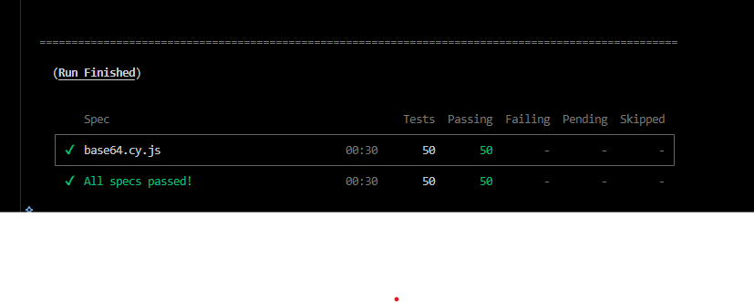
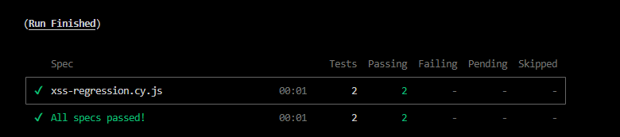
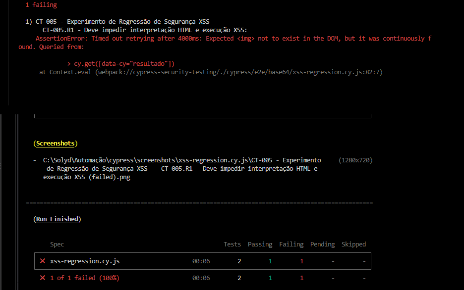
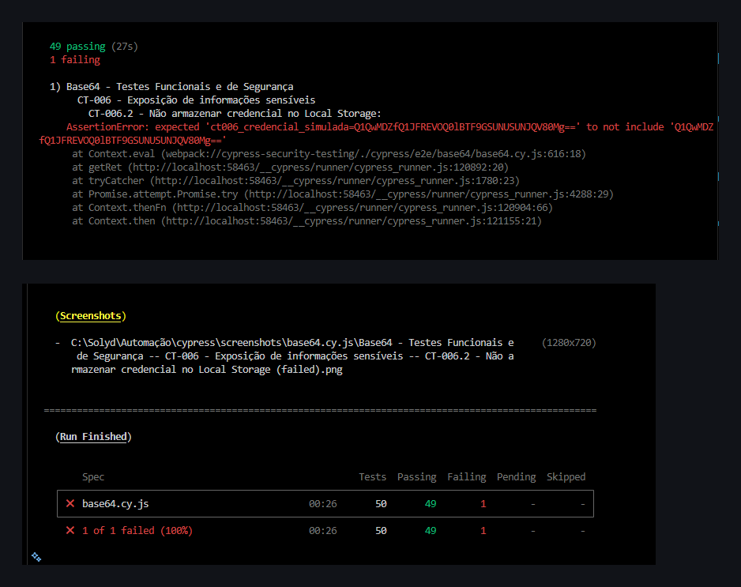

# Cypress Security Testing

**Automação de Testes Funcionais e de Segurança com Cypress e JavaScript**

Projeto de portfólio profissional em **Quality Assurance (QA), Security Testing e Automação End-to-End (E2E)**.

---

## 1. Apresentação

O **Cypress Security Testing** é um projeto prático de automação de testes funcionais e de segurança, desenvolvido com Cypress, JavaScript e aplicações HTML locais.

O projeto transforma verificações manuais em cenários automatizados e reproduzíveis, utilizando operações de codificação e decodificação Base64 como contexto para investigar a qualidade e a segurança de aplicações web.

O primeiro módulo contempla oito grupos principais de testes, além de experimentos independentes de regressão XSS.

Os cenários abordam:

- Codificação e decodificação Base64.
- Tratamento de entradas inválidas.
- Integridade de caracteres Unicode.
- Tratamento seguro de conteúdo HTML.
- Prevenção e detecção de Cross-Site Scripting (XSS).
- Exposição de informações fictícias.
- Processamento de entradas extensas.
- Persistência de dados no navegador.

Também foram desenvolvidas aplicações **intencionalmente vulneráveis**, utilizadas exclusivamente em ambiente controlado para demonstrar que os testes automatizados conseguem identificar determinados comportamentos inseguros.

### 1.1. Objetivos

1. Desenvolver cenários automatizados com Cypress e JavaScript.
2. Aplicar testes positivos, negativos e parametrizados.
3. Avaliar integridade de dados e tratamento de erros.
4. Identificar comportamentos potencialmente inseguros.
5. Demonstrar a detecção de regressões de segurança.
6. Diferenciar falhas reais, comportamentos esperados e vulnerabilidades intencionais.
7. Produzir evidências técnicas reproduzíveis.
8. Construir um portfólio profissional de QA Security.

### 1.2. Escopo de segurança

Todos os testes são executados em aplicações locais desenvolvidas especificamente para fins educacionais.

Os experimentos utilizam dados fictícios e não envolvem sistemas de terceiros.

**Atenção:** as versões vulneráveis não devem ser utilizadas em produção nem hospedadas publicamente sem isolamento e controles apropriados.

O projeto não representa uma auditoria de segurança completa, um pentest abrangente ou uma certificação de ausência de vulnerabilidades.

---

## 2. Resultados consolidados

### 2.1. Execuções normais

| Indicador | Resultado |
|---|---:|
| Grupos principais concluídos | 8 |
| Testes em `base64.cy.js` | 50 |
| Testes em `xss-regression.cy.js` | 2 |
| Total implementado | 52 |
| Testes aprovados nas execuções normais | 52 |
| Falhas nas execuções normais | 0 |

**Status do módulo Base64: CONCLUÍDO — 52 testes aprovados.**

Os resultados foram confirmados em execuções normais separadas das duas suítes. A soma representa a cobertura implementada e aprovada, não necessariamente uma única execução conjunta.

### 2.2. Experimentos de regressão de segurança

| Experimento | Testes | Aprovados | Reprovações intencionais |
|---|---:|---:|---:|
| Regressão XSS — CT-005 | 2 | 1 | 1 |
| Regressão de exposição — CT-006 | 50 | 49 | 1 |

Nas simulações, uma reprovação intencional indica que a regra automatizada identificou o comportamento inseguro introduzido na aplicação vulnerável.

### 2.3. Evidências

As quatro evidências foram organizadas na pasta `evidencias/` e podem ser visualizadas diretamente no repositório.

| Evidência | Descrição | Arquivo |
|---|---|---|
| 01 | 50 testes Base64 aprovados | [Visualizar](evidencias/01_base64_50_testes.png) |
| 02 | 2 testes XSS aprovados | [Visualizar](evidencias/02_xss_2_testes.png) |
| 03 | Regressão XSS detectada | [Visualizar](evidencias/03_regressao_xss.png) |
| 04 | Exposição no Local Storage detectada | [Visualizar](evidencias/04_regressao_exposicao.png) |

#### Evidência 01 — Execução principal



**Resultado:** 50 testes executados e 50 aprovados.

#### Evidência 02 — Execução normal da regressão XSS



**Resultado:** 2 testes executados e 2 aprovados.

#### Evidência 03 — Regressão XSS intencional



**Resultado:** 2 testes executados, 1 aprovado e 1 reprovado intencionalmente.

#### Evidência 04 — Regressão de exposição intencional



**Resultado:** 50 testes executados, 49 aprovados e 1 reprovado intencionalmente.

---

## 3. Tecnologias utilizadas

| Tecnologia | Finalidade |
|---|---|
| Cypress 16.2.1 | Automação de testes E2E |
| JavaScript | Desenvolvimento dos testes e das aplicações |
| HTML5 | Interfaces locais de laboratório |
| Node.js 24.21.0 | Ambiente de execução JavaScript |
| npm 11.19.0 | Gerenciamento de dependências |
| Visual Studio Code | Ambiente de desenvolvimento |
| Windows | Sistema operacional utilizado |
| Git Bash | Terminal de execução |
| Git e GitHub | Versionamento e apresentação do projeto |
| OWASP | Referências de testes de segurança |

### 3.1. Verificação de dependências

Foi executado:

```bash
npm audit --audit-level=high
```

Resultado registrado:

```text
found 0 vulnerabilities
```

O resultado informa que a auditoria não encontrou vulnerabilidades conhecidas nas dependências examinadas naquela execução.

Isso não garante ausência de vulnerabilidades desconhecidas ou de problemas de segurança nas aplicações.

### 3.2. Navegador

As execuções pelo terminal utilizaram o navegador Electron em modo headless.

O Cypress apresentou um aviso de descontinuação futura do Electron como navegador de testes.

Esse aviso não impediu as execuções nem alterou os resultados apresentados.

A configuração do navegador foi mantida nesta versão do projeto.

---

## 4. Estrutura do projeto

```text
Automação/
│
├── app/
│   ├── index.html
│   ├── index-vulnerable.html
│   └── index-exposure.html
│
├── cypress/
│   ├── e2e/
│   │   └── base64/
│   │       ├── base64.cy.js
│   │       └── xss-regression.cy.js
│   │
│   ├── fixtures/
│   └── support/
│
├── evidencias/
│   ├── 01_base64_50_testes.png
│   ├── 02_xss_2_testes.png
│   ├── 03_regressao_xss.png
│   └── 04_regressao_exposicao.png
│
├── .gitignore
├── cypress.config.js
├── package.json
├── package-lock.json
└── README.md
```

A pasta `node_modules/` é criada durante a instalação das dependências e não deve ser versionada.

Capturas automáticas, vídeos e downloads temporários do Cypress também são excluídos do versionamento pelo `.gitignore`.

### 4.1. Descrição dos principais arquivos

| Arquivo | Finalidade |
|---|---|
| `app/index.html` | Aplicação segura de referência |
| `app/index-vulnerable.html` | Aplicação intencionalmente vulnerável a XSS |
| `app/index-exposure.html` | Demonstração de armazenamento inseguro de informações fictícias |
| `base64.cy.js` | Testes principais CT-001 a CT-008 |
| `xss-regression.cy.js` | Experimentos CT-005.R1 e CT-005.R2 |
| `cypress.config.js` | Configuração E2E do Cypress |
| `package.json` | Dependências e comandos de execução |
| `package-lock.json` | Registro das versões resolvidas |
| `.gitignore` | Exclusão de arquivos desnecessários do Git |
| `evidencias/` | Capturas selecionadas dos resultados |
| `README.md` | Documentação técnica do projeto |

---

# MÓDULO 01 — BASE64

## 5. Fundamentação técnica

Base64 é um mecanismo de codificação que representa dados binários utilizando caracteres textuais.

É empregado em contextos de transporte e representação de dados, mas não oferece confidencialidade.

**Base64 não é criptografia.**

Não utiliza uma chave secreta para proteger as informações e pode ser revertido por quem possui a sequência codificada.

### 5.1. Codificação

A aplicação converte a entrada textual para bytes UTF-8 utilizando `TextEncoder`.

Depois, os bytes são representados em uma string binária compatível com `btoa()`, responsável pela codificação Base64.

### 5.2. Decodificação

A aplicação utiliza `atob()` para recuperar os bytes.

Em seguida, usa `TextDecoder` para converter os bytes em texto UTF-8.

```javascript
new TextDecoder('utf-8', {
  fatal: true
})
```

A opção `fatal: true` faz com que sequências de bytes inválidas para UTF-8 gerem uma exceção, em vez de serem substituídas silenciosamente por caracteres de reposição.

### 5.3. Tratamento seguro de conteúdo

A aplicação segura apresenta os resultados com:

```javascript
resultado.textContent = texto;
```

Assim, o conteúdo é interpretado como texto literal.

A aplicação intencionalmente vulnerável utiliza:

```javascript
resultado.innerHTML = texto;
```

Nesse caso, dados não confiáveis podem ser interpretados como marcação HTML e permitir a execução de manipuladores de eventos JavaScript.

Essa diferença constitui a base do experimento CT-005.

---

## 6. Matriz principal de cobertura

| Grupo | Finalidade | Testes | Status |
|---|---|---:|---|
| CT-001 | Codificação Base64 | 6 | Aprovado |
| CT-002 | Decodificação Base64 | 6 | Aprovado |
| CT-003 | Tratamento de entradas inválidas | 6 | Aprovado |
| CT-004 | Integridade Unicode | 8 | Aprovado |
| CT-005 | Tratamento seguro de HTML e XSS | 6 | Aprovado |
| CT-006 | Exposição de informações fictícias | 6 | Aprovado |
| CT-007 | Processamento de entradas extensas | 6 | Aprovado |
| CT-008 | Persistência de dados no navegador | 6 | Aprovado |
| **Total** | | **50** | **Aprovado** |

A suíte independente `xss-regression.cy.js` adiciona dois testes, totalizando 52.

---

# CT-001 — CODIFICAÇÃO BASE64

**Categoria:** Teste funcional positivo
**Técnica:** Data-Driven Testing
**Arquivo:** `base64.cy.js`
**Status:** APROVADO — 6/6

## 7. Objetivo

Verificar se a aplicação produz corretamente a representação Base64 de diferentes entradas textuais, preservando seus caracteres e sua sequência original.

## 7.1. Procedimento geral

1. Selecionar a entrada.
2. Calcular o resultado esperado utilizando `Cypress.Buffer`.
3. Abrir a aplicação segura.
4. Preencher o campo de entrada.
5. Acionar o botão **Codificar**.
6. Comparar o resultado apresentado com a referência calculada.

Trecho representativo:

```javascript
const resultadoEsperado = Cypress.Buffer
  .from(texto, 'utf8')
  .toString('base64');

cy.get('[data-cy="codificar"]').click();

cy.get('[data-cy="resultado"]')
  .should('have.text', resultadoEsperado);
```

## 7.2. Casos de teste

### CT-001.1 — Texto ASCII simples

**Entrada:** `test`

**Objetivo:** validar a codificação de uma sequência ASCII curta.

**Resultado esperado:** `dGVzdA==`

**Resultado obtido:** aprovado.

**Análise:** o texto foi codificado conforme a referência esperada.

### CT-001.2 — Texto alfabético

**Entrada:** `Cypress`

**Objetivo:** validar texto com letras maiúsculas e minúsculas.

**Resultado esperado:** `Q3lwcmVzcw==`

**Resultado obtido:** aprovado.

**Análise:** a aplicação preservou a sequência textual.

### CT-001.3 — Texto com espaços

**Entrada:** `Seguranca da Informacao`

**Objetivo:** verificar o tratamento de espaços entre palavras.

**Resultado esperado:** `U2VndXJhbmNhIGRhIEluZm9ybWFjYW8=`

**Resultado obtido:** aprovado.

**Análise:** não houve divergência na codificação.

### CT-001.4 — Caracteres numéricos

**Entrada:** `123456789`

**Objetivo:** verificar que dígitos sejam processados como caracteres textuais.

**Resultado esperado:** `MTIzNDU2Nzg5`

**Resultado obtido:** aprovado.

**Análise:** os caracteres foram preservados.

### CT-001.5 — Acentos e pontuação

**Entrada:** `Olá, mundo!`

**Objetivo:** validar a codificação UTF-8 de caracteres acentuados.

**Resultado esperado:** `T2zDoSwgbXVuZG8h`

**Resultado obtido:** aprovado.

**Análise:** a representação Base64 correspondeu aos bytes UTF-8 esperados.

### CT-001.6 — Emoji e texto

**Entrada:** `QA 🔐 Security`

**Objetivo:** verificar o processamento de um emoji representado por múltiplos bytes.

**Resultado esperado:** `UUEg8J+UkCBTZWN1cml0eQ==`

**Resultado obtido:** aprovado.

**Análise:** a entrada foi codificada corretamente.

## 7.3. Critério de aprovação

A saída Base64 deve corresponder exatamente ao resultado esperado.

## 7.4. Resultado consolidado

**6 de 6 testes aprovados.**

Nenhuma vulnerabilidade foi identificada nesses cenários.

A aprovação não implica proteção criptográfica.

---

# CT-002 — DECODIFICAÇÃO BASE64

**Categoria:** Teste funcional positivo
**Técnica:** Data-Driven Testing
**Arquivo:** `base64.cy.js`
**Status:** APROVADO — 6/6

## 8. Objetivo

Verificar se a aplicação recupera corretamente o texto original a partir de uma sequência Base64 válida.

## 8.1. Procedimento geral

1. Preparar o texto original.
2. Calcular sua representação Base64.
3. Acessar a aplicação segura.
4. Informar o valor codificado.
5. Acionar **Decodificar**.
6. Comparar o texto recuperado com a entrada original.

Trecho representativo:

```javascript
const textoCodificado = Cypress.Buffer
  .from(texto, 'utf8')
  .toString('base64');

cy.get('[data-cy="decodificar"]').click();

cy.get('[data-cy="resultado"]')
  .should('have.text', texto);
```

## 8.2. Casos de teste

### CT-002.1 — Recuperação de texto ASCII

**Entrada Base64:** `dGVzdA==`

**Resultado esperado:** `test`

**Resultado obtido:** aprovado.

**Análise:** a decodificação recuperou exatamente a entrada.

### CT-002.2 — Recuperação de texto alfabético

**Entrada Base64:** `Q3lwcmVzcw==`

**Resultado esperado:** `Cypress`

**Resultado obtido:** aprovado.

**Análise:** os caracteres foram recuperados corretamente.

### CT-002.3 — Recuperação de texto com espaços

**Entrada:** representação Base64 de `Seguranca da Informacao`.

**Resultado esperado:** `Seguranca da Informacao`

**Resultado obtido:** aprovado.

**Análise:** os espaços foram preservados.

### CT-002.4 — Recuperação de números

**Entrada Base64:** `MTIzNDU2Nzg5`

**Resultado esperado:** `123456789`

**Resultado obtido:** aprovado.

**Análise:** os dígitos foram mantidos como texto.

### CT-002.5 — Recuperação de acentos

**Entrada:** representação Base64 de `Olá, mundo!`.

**Resultado esperado:** `Olá, mundo!`

**Resultado obtido:** aprovado.

**Análise:** a decodificação preservou a representação UTF-8.

### CT-002.6 — Recuperação de emoji

**Entrada:** representação Base64 de `QA 🔐 Security`.

**Resultado esperado:** `QA 🔐 Security`

**Resultado obtido:** aprovado.

**Análise:** o emoji e os demais caracteres foram recuperados.

## 8.3. Critério de aprovação

O texto decodificado deve corresponder exatamente ao original.

## 8.4. Resultado consolidado

**6 de 6 testes aprovados.**

A reversibilidade observada é uma característica normal do Base64.

---

# CT-003 — TRATAMENTO DE ENTRADAS INVÁLIDAS

**Categoria:** Teste negativo e recuperação funcional
**Técnicas:** Negative Testing, Error Handling e Recovery Testing
**Arquivo:** `base64.cy.js`
**Status:** APROVADO — 6/6

## 9. Objetivo

Investigar o comportamento da aplicação diante de entradas inválidas e verificar se o processamento continua funcionando após uma falha.

## 9.1. Casos de teste

### CT-003.1 — Caracteres não permitidos

**Entrada:** `###`

**Objetivo:** avaliar o tratamento de caracteres inválidos para Base64.

**Procedimento:** informar a entrada e executar a decodificação.

**Resultado esperado:** `Erro na decodificação`.

**Resultado obtido:** aprovado.

**Análise:** a aplicação apresentou erro controlado.

### CT-003.2 — Comprimento inválido

**Entrada:** `a`

**Objetivo:** verificar o tratamento de uma entrada incompleta.

**Resultado esperado:** erro controlado.

**Resultado obtido:** aprovado.

**Análise:** a aplicação rejeitou a entrada no contexto testado.

### CT-003.3 — Padding excessivo

**Entrada:** `dGVzdA===`

**Objetivo:** investigar o tratamento de caracteres de preenchimento em quantidade inadequada.

**Resultado esperado:** `Erro na decodificação`.

**Resultado obtido:** aprovado.

**Análise:** a aplicação apresentou a mensagem esperada.

### CT-003.4 — Bytes inválidos para UTF-8

**Entrada:** `/w==`

**Objetivo:** verificar o tratamento de uma representação Base64 que produz um byte incompatível com uma sequência UTF-8 válida.

**Resultado esperado:** erro controlado.

**Resultado obtido:** aprovado.

**Análise:** a configuração `TextDecoder` com `fatal: true` permitiu identificar a conversão textual inválida.

### CT-003.5 — Não manter resultado anterior após erro

**Objetivo:** confirmar que um resultado válido antigo seja substituído por uma mensagem de erro após uma operação inválida.

**Procedimento:**

1. Decodificar `dGVzdA==`.
2. Confirmar `test`.
3. Substituir a entrada por `###`.
4. Executar novamente a decodificação.

**Resultado esperado:** `Erro na decodificação`, substituindo `test`.

**Resultado obtido:** aprovado.

**Análise:** o resultado anterior não permaneceu sendo exibido como resposta da nova operação.

### CT-003.6 — Recuperação após erro

**Objetivo:** verificar a recuperação funcional após uma falha.

**Procedimento:**

1. Decodificar `###`.
2. Confirmar o erro.
3. Substituir a entrada por `Q3lwcmVzcw==`.
4. Executar a decodificação.

**Resultado esperado:** `Cypress`.

**Resultado obtido:** aprovado.

**Análise:** a aplicação continuou funcionando após uma entrada inválida.

## 9.2. Critério de aprovação

As entradas inválidas devem gerar erros controlados e não comprometer a operação seguinte.

## 9.3. Resultado consolidado

**6 de 6 testes aprovados.**

Nenhuma falha funcional foi identificada nas entradas avaliadas.

---

# CT-004 — CARACTERES ESPECIAIS E UNICODE

**Categoria:** Testes de integridade textual
**Técnicas:** Unicode Testing e Data-Driven Testing
**Arquivo:** `base64.cy.js`
**Status:** APROVADO — 8/8

## 10. Objetivo

Verificar se a aplicação preserva diferentes representações Unicode durante as operações de codificação e decodificação.

## 10.1. Casos de teste

### CT-004.1 — Caracteres acentuados

**Entrada:** `Árvore, ação e coração`

**Objetivo:** verificar a preservação de acentos utilizados na língua portuguesa.

**Procedimento:** codificar, verificar o Base64, decodificar e comparar com a entrada.

**Resultado esperado:** recuperação integral.

**Resultado obtido:** aprovado.

**Análise:** os caracteres foram preservados.

### CT-004.2 — Caracteres chineses

**Entrada:** `你好，世界`

**Objetivo:** validar a codificação UTF-8 de caracteres chineses.

**Resultado esperado:** recuperação exata da sequência.

**Resultado obtido:** aprovado.

**Análise:** não houve alteração textual.

### CT-004.3 — Caracteres árabes

**Entrada:** `مرحبا بالعالم`

**Objetivo:** validar o processamento de caracteres árabes.

**Resultado esperado:** recuperação exata da sequência.

**Resultado obtido:** aprovado.

**Análise:** a integridade textual foi preservada.

O teste não avalia todos os aspectos visuais da escrita bidirecional.

### CT-004.4 — Emojis

**Entrada:** `QA 🔐🚀`

**Objetivo:** verificar caracteres Unicode representados por múltiplos bytes.

**Resultado esperado:** recuperação exata.

**Resultado obtido:** aprovado.

**Análise:** os emojis foram preservados.

### CT-004.5 — Acento combinante

**Entrada:** `Cafe\u0301`

**Objetivo:** verificar a preservação de uma sequência formada por letra base e acento combinante.

**Procedimento:** inserir a sequência exata programaticamente, codificar e decodificar.

**Resultado esperado:** recuperação sem normalização ou alteração.

**Resultado obtido:** aprovado.

**Análise:** a representação original foi preservada.

### CT-004.6 — Símbolos especiais

**Entrada:** `Preço: € 10 © ™`

**Objetivo:** verificar o processamento de símbolos monetários e especiais.

**Resultado esperado:** recuperação integral.

**Resultado obtido:** aprovado.

**Análise:** os símbolos foram preservados.

### CT-004.7 — Caractere invisível

**Entrada:** `A\u200BB`

A sequência contém um Zero Width Space (U+200B).

**Objetivo:** verificar se o caractere invisível permanece na sequência textual.

**Resultado esperado:** recuperação exata, sem remoção silenciosa.

**Resultado obtido:** aprovado.

**Análise:** a aplicação preservou a entrada.

### CT-004.8 — Normalização Unicode NFC e NFD

**Entradas:**

```javascript
const textoNFC = 'Café';
const textoNFD = 'Cafe\u0301';
```

**Objetivo:** demonstrar que sequências visualmente semelhantes podem possuir representações Unicode diferentes.

**Procedimento:**

1. Comparar as duas strings originais.
2. Confirmar que são diferentes.
3. Normalizar ambas para NFC.
4. Confirmar a equivalência após normalização.
5. Verificar que seus valores Base64 originais são diferentes.
6. Confirmar os resultados produzidos pela aplicação.

**Resultado esperado:** codificações diferentes para as sequências originais.

**Resultado obtido:** aprovado.

**Análise:** a aplicação preservou a distinção entre NFC e NFD.

## 10.2. Considerações de segurança

Representações Unicode diferentes podem causar inconsistências em mecanismos de comparação, identificação e validação textual.

A normalização não é necessariamente adequada para todos os dados. Neste laboratório, o comportamento esperado é preservar a sequência original.

## 10.3. Resultado consolidado

**8 de 8 testes aprovados.**

Nenhuma vulnerabilidade foi identificada nesses cenários.

---

# CT-005 — TRATAMENTO SEGURO DE HTML E XSS

**Categoria:** Security Testing
**Técnicas:** Input Handling e XSS Testing
**Arquivo:** `base64.cy.js`
**Status:** APROVADO — 6/6

## 11. Objetivo

Verificar se a aplicação segura trata conteúdo HTML decodificado como texto literal, evitando a criação de elementos HTML ativos ou a execução dos manipuladores de eventos avaliados.

## 11.1. Casos de teste

### CT-005.1 — Tag HTML strong

**Entrada:**

```html
<strong>QA Security</strong>
```

**Objetivo:** verificar se o navegador cria uma tag HTML de formatação.

**Resultado esperado:** conteúdo literal, sem criação do elemento `strong`.

**Resultado obtido:** aprovado.

**Análise:** o conteúdo permaneceu como texto.

### CT-005.2 — Imagem com onerror

**Entrada:**

```html

```

**Objetivo:** verificar se a aplicação impede a criação da imagem e a execução do manipulador de evento.

**Resultado esperado:** ausência de elemento injetado e indicador de execução falso.

**Resultado obtido:** aprovado.

**Análise:** o payload não foi interpretado como HTML ativo.

### CT-005.3 — SVG com onload

**Entrada:**

```html
<svg onload="window.__xssExecutado=true"></svg>
```

**Objetivo:** verificar se o conteúdo SVG permanece literal.

**Resultado esperado:** nenhum SVG criado e nenhuma execução.

**Resultado obtido:** aprovado.

**Análise:** o conteúdo foi apresentado como texto.

### CT-005.4 — Tag script

**Entrada:**

```html
<script>window.__xssExecutado=true</script>
```

**Objetivo:** confirmar a apresentação literal de uma tag `script`.

**Resultado esperado:** nenhum elemento ativo criado.

**Resultado obtido:** aprovado.

**Análise:** o conteúdo permaneceu literal.

Uma tag `script` inserida por `innerHTML` normalmente não executa diretamente. Por isso, os testes também utilizam exemplos com manipuladores de eventos.

### CT-005.5 — Iframe com srcdoc

**Entrada:**

```html
<iframe srcdoc="<p>Teste</p>"></iframe>
```

**Objetivo:** verificar se a aplicação cria um documento incorporado.

**Resultado esperado:** nenhum iframe criado.

**Resultado obtido:** aprovado.

**Análise:** o conteúdo permaneceu literal.

### CT-005.6 — Entidades e tags aninhadas

**Entrada:**

```html
&lt;b&gt;teste&lt;/b&gt;<div><em>Conteúdo</em></div>
```

**Objetivo:** verificar a preservação de entidades HTML e tags aninhadas.

**Resultado esperado:** conteúdo literal, sem elementos descendentes.

**Resultado obtido:** aprovado.

**Análise:** não ocorreu interpretação de marcação HTML.

## 11.2. Verificações automatizadas

```javascript
cy.get('[data-cy="resultado"]')
  .should('have.text', cenario.conteudo);

cy.get('[data-cy="resultado"]')
  .find('*')
  .should('not.exist');

cy.window()
  .its('__xssExecutado')
  .should('eq', false);
```

## 11.3. Critério de aprovação

O conteúdo deve permanecer literal, sem criação de elementos HTML descendentes nem execução do indicador JavaScript de demonstração.

## 11.4. Resultado consolidado

**6 de 6 testes aprovados.**

Nenhuma execução indevida foi identificada no ponto de inserção e nos payloads avaliados.

---

# CT-005 — EXPERIMENTO DE REGRESSÃO XSS

**Categoria:** Security Regression Testing
**Arquivo:** `xss-regression.cy.js`
**Status:** CONCLUÍDO

## 12. Objetivo

Demonstrar que uma automação consegue detectar uma alteração insegura introduzida intencionalmente em uma aplicação anteriormente protegida.

### Aplicações comparadas

| Página | Implementação | Finalidade |
|---|---|---|
| `app/index.html` | `textContent` | Referência segura |
| `app/index-vulnerable.html` | `innerHTML` | Regressão intencional |

### Payload controlado

```html

```

O payload não envia informações a servidores externos. Ele altera uma variável de controle quando executado.

## 12.1. CT-005.R1 — Validar proteção contra XSS

**Objetivo:** confirmar que conteúdo não confiável permaneça literal.

**Procedimento:**

1. Selecionar a aplicação segura ou vulnerável.
2. Inicializar `window.__xssExecutado` como falso.
3. Informar o payload em Base64.
4. Executar a decodificação.
5. Verificar a ausência do elemento `img`.
6. Confirmar a preservação literal do texto.
7. Confirmar que o indicador continua falso.

**Resultado esperado na aplicação segura:** aprovação.

**Resultado obtido na aplicação segura:** aprovado.

**Resultado esperado na regressão simulada:** reprovação intencional.

**Resultado obtido na regressão simulada:** reprovado intencionalmente.

### Evidência técnica

A mensagem registrada foi:

```text
AssertionError: Timed out retrying after 4000ms:
Expected  not to exist in the DOM,
but it was continuously found.
```

A falha identifica que o elemento HTML foi criado na aplicação intencionalmente vulnerável.

## 12.2. CT-005.R2 — Controle positivo de XSS

**Objetivo:** confirmar que o payload controlado é interpretado e executado na aplicação vulnerável.

**Procedimento:**

1. Acessar `app/index-vulnerable.html`.
2. Inicializar o indicador.
3. Informar o payload codificado.
4. Executar a decodificação.
5. Confirmar a existência do elemento `img`.
6. Confirmar que `window.__xssExecutado` passou a `true`.

**Resultado esperado:** aprovação do controle positivo.

**Resultado obtido:** aprovado.

**Análise:** o teste confirmou a criação do elemento e a execução controlada do manipulador de evento.

## 12.3. Resultados comparativos

| Verificação | Aplicação segura | Aplicação vulnerável |
|---|---|---|
| Conteúdo literal | Sim | Não |
| Elemento HTML injetado | Não | Sim |
| Manipulador executado | Não | Sim |
| CT-005.R1 | Aprova | Reprova |
| CT-005.R2 | Não aplicável | Aprova |

### Classificação

- Categoria: Cross-Site Scripting (XSS).
- Contexto: inserção insegura de conteúdo no DOM.
- Referência relacionada: CWE-79.
- Causa demonstrada: utilização de `innerHTML` com conteúdo não confiável.

### Correção demonstrada

Substituir:

```javascript
resultado.innerHTML = texto;
```

Por:

```javascript
resultado.textContent = texto;
```

A aplicação de referência utiliza a implementação segura.

## 12.4. Evidência


**Resultado registrado:** 1 teste aprovado e 1 falha intencional.

A execução comprova a detecção da regressão específica, não a cobertura de todas as variantes possíveis de XSS.

---

# CT-006 — EXPOSIÇÃO DE INFORMAÇÕES SENSÍVEIS

**Categoria:** Security Testing
**Técnicas:** Negative Testing, Storage Inspection e Security Regression Testing
**Arquivo:** `base64.cy.js`
**Status:** APROVADO — 6/6

## 13. Objetivo

Investigar o risco de armazenar informações que exigem confidencialidade utilizando apenas codificação Base64.

O experimento utiliza uma credencial exclusivamente fictícia:

```text
CT006_CREDENCIAL_FICTICIA_42
```

A aplicação vulnerável grava o Base64 no `localStorage` utilizando a chave:

```text
ct006_credencial_simulada
```

## 13.1. Casos de teste

### CT-006.1 — Demonstrar reversibilidade do Base64

**Objetivo:** confirmar que uma credencial fictícia codificada pode ser recuperada sem chave secreta.

**Procedimento:**

1. Acessar a aplicação segura.
2. Informar a credencial fictícia.
3. Codificar em Base64.
4. Recuperar o resultado apresentado.
5. Decodificar a representação utilizando `Cypress.Buffer`.
6. Comparar com o valor original.

**Resultado esperado:** recuperação integral da credencial fictícia.

**Resultado obtido:** aprovado.

**Análise:** a reversibilidade do Base64 é esperada e não representa uma vulnerabilidade isolada.

### CT-006.2 — Ausência de credencial no Local Storage

**Objetivo:** verificar se a aplicação segura armazena o texto fictício ou sua representação Base64 no `localStorage`.

**Procedimento:**

1. Acessar a aplicação selecionada.
2. Codificar a credencial fictícia.
3. Inspecionar o Local Storage.
4. Procurar pelo texto original e pelo Base64 correspondente.

**Resultado esperado na aplicação segura:** nenhuma das representações armazenada.

**Resultado obtido na execução normal:** aprovado.

**Resultado esperado na simulação de regressão:** reprovação intencional.

**Resultado obtido na regressão:** reprovado intencionalmente.

**Análise:** o teste identificou a presença do Base64 na aplicação de exposição.

### CT-006.3 — Ausência de credencial no Session Storage

**Objetivo:** verificar se a aplicação segura grava a credencial fictícia no armazenamento da sessão.

**Procedimento:** codificar o texto e inspecionar as chaves e valores do `sessionStorage`.

**Resultado esperado:** nenhuma das representações armazenada.

**Resultado obtido:** aprovado.

**Análise:** não foi identificada a credencial no Session Storage inspecionado.

### CT-006.4 — Ausência de credencial na URL

**Objetivo:** verificar se a operação acrescenta a credencial fictícia à URL da aplicação.

**Procedimento:** codificar a entrada e inspecionar o endereço atual.

**Resultado esperado:** ausência do texto original e do Base64 correspondente.

**Resultado obtido:** aprovado.

**Análise:** não foi identificada exposição na URL atual.

O teste não cobre outros possíveis meios de transmissão ou registro de informações.

### CT-006.5 — Confirmar armazenamento inseguro

**Objetivo:** demonstrar o armazenamento intencional da credencial fictícia na aplicação vulnerável.

**Procedimento:**

1. Acessar `app/index-exposure.html`.
2. Informar `CT006_CREDENCIAL_FICTICIA_42`.
3. Executar a codificação e o armazenamento.
4. Inspecionar a chave `ct006_credencial_simulada`.
5. Comparar o valor com o Base64 esperado.

**Resultado esperado:** confirmação do armazenamento.

**Resultado obtido:** aprovado.

**Análise:** a aprovação confirma a reprodução do comportamento inseguro, não a segurança da implementação.

### CT-006.6 — Recuperar credencial fictícia armazenada

**Objetivo:** demonstrar que um script da mesma origem consegue recuperar a informação armazenada.

**Procedimento:**

1. Armazenar a credencial fictícia na aplicação vulnerável.
2. Ler o valor da chave no Local Storage.
3. Decodificar utilizando `atob()`.
4. Comparar com o texto original.

**Resultado esperado:** recuperação da credencial sem chave secreta.

**Resultado obtido:** aprovado.

**Análise:** o experimento confirmou a reversibilidade do valor armazenado.

## 13.2. Vulnerabilidade intencional

Trecho da aplicação vulnerável:

```javascript
localStorage.setItem(
  'ct006_credencial_simulada',
  base64
);
```

O armazenamento não é, por si só, uma falha universal de segurança. O risco demonstrado está na utilização desse mecanismo para guardar informações que deveriam permanecer confidenciais.

### Classificação

- Categoria: armazenamento inadequado de informações sensíveis.
- Referência relacionada: CWE-922.
- Dados utilizados: exclusivamente fictícios.
- Ambiente: laboratório local.

### Recomendações de segurança

- Não utilizar Base64 como proteção de credenciais.
- Evitar armazenar segredos de autenticação em mecanismos acessíveis por JavaScript.
- Utilizar mecanismos apropriados de sessão e autenticação.
- Limitar a retenção de informações confidenciais.
- Não utilizar credenciais reais nos experimentos.

## 13.3. Resultado consolidado

**Execução normal:** 6 de 6 testes aprovados.

**Regressão simulada:** CT-006.2 reprovado intencionalmente.

### Evidência


A execução registrada após a inclusão do CT-008 apresentou:

**50 testes executados, 49 aprovados e 1 falha intencional.**

---

# CT-007 — PROCESSAMENTO DE ENTRADAS EXTENSAS

**Categoria:** Teste de robustez e integridade
**Técnicas:** Data Integrity Testing, Boundary-Oriented Testing e Recovery Testing
**Arquivo:** `base64.cy.js`
**Status:** APROVADO — 6/6

## 14. Objetivo

Avaliar a integridade do processamento Base64 diante de entradas com tamanhos diferentes e verificar a continuidade funcional após uma sequência de operações.

O CT-007 investiga possíveis problemas de truncamento, corrupção, recuperação incompleta e falhas de processamento.

Não constitui teste de carga, estresse ou negação de serviço.

### 14.1. Unidades utilizadas

Os tamanhos são registrados em KiB:

**1 KiB = 1.024 bytes.**

Em UTF-8, o número de bytes pode ser diferente da quantidade de caracteres.

## 14.2. Casos de teste

### CT-007.1 — Entrada vazia

**Entrada:** string vazia.

**Volume:** 0 bytes.

**Objetivo:** verificar o processamento do valor limite inferior.

**Procedimento:**

1. Acessar a aplicação segura.
2. Definir o campo como vazio.
3. Executar a codificação.
4. Confirmar resultado vazio.
5. Executar a decodificação.
6. Confirmar recuperação de string vazia.

**Resultado esperado:** operações sem erros inesperados.

**Resultado obtido:** aprovado.

**Análise:** a aplicação processou a entrada vazia conforme o comportamento esperado.

### CT-007.2 — Texto ASCII de 1 KiB

**Entrada:**

```javascript
'A'.repeat(1024)
```

**Volume:** 1.024 bytes.

**Objetivo:** verificar integridade de uma entrada maior que os exemplos funcionais iniciais.

**Procedimento:** inserir, codificar, comparar o Base64, decodificar e comparar com o original.

**Resultado esperado:** recuperação exata de 1.024 caracteres.

**Resultado obtido:** aprovado.

**Análise:** não ocorreu divergência no conteúdo avaliado.

### CT-007.3 — Unicode de 16 KiB

**Entrada:**

```javascript
'á🔐'.repeat(2730) + 'ABCD'
```

**Volume:** 16.384 bytes em UTF-8.

**Objetivo:** verificar o processamento de caracteres que ocupam quantidades diferentes de bytes.

**Procedimento:**

1. Gerar a entrada Unicode.
2. Calcular o tamanho em bytes.
3. Inserir a sequência.
4. Confirmar a integridade do campo.
5. Codificar.
6. Comparar com o Base64 esperado.
7. Decodificar.
8. Comparar com a sequência original.

**Resultado esperado:** preservação integral.

**Resultado obtido:** aprovado.

**Análise:** os caracteres acentuados, emojis e caracteres ASCII foram recuperados corretamente.

### CT-007.4 — Entrada repetitiva de 64 KiB

**Entrada:**

```javascript
'ABCD'.repeat(16 * 1024)
```

**Volume:** 65.536 bytes.

**Objetivo:** verificar se uma entrada repetitiva extensa é processada sem truncamento.

**Procedimento:** codificar e decodificar, comparando os resultados completos.

**Resultado esperado:** correspondência exata com o original.

**Resultado obtido:** aprovado.

**Análise:** não foi identificada perda de conteúdo.

### CT-007.5 — Entrada de 128 KiB

**Entrada:**

```javascript
'Z'.repeat(128 * 1024)
```

**Volume:** 131.072 bytes.

**Objetivo:** verificar o maior volume definido para o CT-007.

**Procedimento:**

1. Gerar a entrada.
2. Calcular o Base64 esperado.
3. Inserir o conteúdo.
4. Codificar.
5. Validar comprimento e conteúdo.
6. Decodificar.
7. Validar comprimento e recuperação exata.

**Resultado esperado:** preservação integral dos 131.072 bytes ASCII originais.

**Resultado obtido:** aprovado.

**Análise:** a aplicação processou o volume selecionado nas condições observadas.

Esse resultado não significa que 128 KiB seja o limite máximo suportado pela aplicação.

### CT-007.6 — Recuperação após entrada extensa

**Sequência:**

| Etapa | Entrada | Resultado esperado |
|---|---|---|
| 1 | 64 KiB de caracteres `L` | Base64 correto |
| 2 | `###` | Erro controlado |
| 3 | `OK` | `T0s=` |

**Objetivo:** verificar se a aplicação continua funcionando após uma entrada extensa seguida por uma entrada inválida.

**Procedimento:**

1. Codificar 64 KiB de texto.
2. Confirmar a saída.
3. Substituir a entrada por `###`.
4. Tentar decodificar.
5. Confirmar `Erro na decodificação`.
6. Substituir a entrada por `OK`.
7. Codificar.
8. Confirmar `T0s=`.

**Resultado obtido:** aprovado.

**Análise:** a aplicação manteve a capacidade de processamento após a sequência avaliada.

## 14.3. Estratégia de automação

Entradas extensas são inseridas programaticamente:

```javascript
cy.get('[data-cy="entrada"]')
  .then(($campo) => {
    $campo.val(texto);
    $campo.trigger('input');
  });
```

Em seguida, o valor é conferido.

A técnica preserva os dados e evita milhares de eventos de teclado.

Ela não representa a simulação de digitação física de todos os caracteres.

## 14.4. Limitações

O CT-007 não mede diretamente:

- Consumo de memória.
- Utilização de CPU.
- Tempo máximo admissível.
- Desempenho sob concorrência.
- Resistência a esgotamento de recursos.
- Limite máximo real de entrada.
- Capacidade de recuperação após falhas de infraestrutura.

## 14.5. Resultado consolidado

**6 de 6 testes aprovados.**

Nenhuma falha de integridade ou recuperação funcional foi identificada nas entradas avaliadas.

---

# CT-008 — PERSISTÊNCIA DE DADOS NO NAVEGADOR

**Categoria:** Security Testing e comportamento de armazenamento
**Técnicas:** Storage Inspection, Persistence Testing e Recovery Testing
**Arquivo:** `base64.cy.js`
**Status:** APROVADO — 6/6

## 15. Objetivo

Investigar o comportamento dos dados após recarregamentos e navegação, diferenciando a ausência de armazenamento, a persistência esperada do navegador e a retenção intencionalmente insegura de uma credencial fictícia.

O CT-008 complementa o CT-006 acrescentando verificações antes e depois de recarregamentos.

### 15.1. Mecanismos avaliados

**Local Storage**

Permite armazenar dados associados à origem e normalmente preserva os valores após recarregamentos e reinícios do navegador.

**Session Storage**

Armazena dados associados à origem e à sessão da aba. Normalmente preserva dados após recarregamentos, mas não após o encerramento definitivo da sessão da aba.

As duas APIs permitem acesso por JavaScript no contexto apropriado.

A utilização desses mecanismos não constitui automaticamente uma vulnerabilidade.

### 15.2. Dados fictícios

Credencial utilizada:

```text
CT008_CREDENCIAL_FICTICIA_42
```

Chave compartilhada com o laboratório do CT-006:

```text
ct006_credencial_simulada
```

Marcador independente do teste de sessão:

```text
CT008_MARCADOR_FICTICIO
```

## 15.3. Casos de teste

### CT-008.1 — Não reexibir resultado após recarregamento

**Objetivo:** verificar se o resultado exibido anteriormente permanece na interface após recarregar a aplicação segura.

**Procedimento:**

1. Acessar `app/index.html`.
2. Codificar a credencial fictícia.
3. Confirmar o Base64 exibido.
4. Executar `cy.reload()`.
5. Inspecionar o elemento de resultado.

**Resultado esperado:** o elemento de resultado deve estar vazio.

**Resultado obtido:** aprovado.

**Análise:** o resultado anterior não foi reexibido no elemento avaliado após a recarga.

**Limitação:** o teste não confirma a limpeza de todos os dados em memória, do campo de entrada ou dos mecanismos de restauração do navegador.

### CT-008.2 — Não persistir credencial no Local Storage da aplicação segura

**Objetivo:** verificar a ausência da credencial original e do Base64 no Local Storage antes e depois de recarregar a página.

**Procedimento:**

1. Acessar a aplicação segura.
2. Codificar a credencial fictícia.
3. Inspecionar as chaves e valores do Local Storage.
4. Confirmar a ausência das representações conhecidas.
5. Recarregar a página.
6. Inspecionar novamente o Local Storage.
7. Confirmar a ausência dos mesmos valores.

**Resultado esperado:** ausência da credencial antes e depois da recarga.

**Resultado obtido:** aprovado.

**Análise:** não foi identificada gravação das representações procuradas durante a sequência avaliada.

O teste não afirma que a aplicação removeu informações anteriormente armazenadas; ele verifica a ausência das representações conhecidas.

### CT-008.3 — Não persistir credencial no Session Storage da aplicação segura

**Objetivo:** verificar se a aplicação segura deixa de armazenar a credencial fictícia no Session Storage durante o processamento.

**Procedimento:**

1. Acessar a aplicação segura.
2. Codificar a credencial.
3. Inspecionar o Session Storage imediatamente.
4. Confirmar a ausência do texto original e do Base64.
5. Recarregar a página.
6. Inspecionar novamente o Session Storage.
7. Confirmar a ausência dos valores.

**Resultado esperado:** ausência antes e depois da recarga.

**Resultado obtido:** aprovado.

**Análise:** nenhuma das representações avaliadas foi encontrada.

### CT-008.4 — Persistência do Local Storage na versão vulnerável

**Objetivo:** demonstrar que uma credencial fictícia armazenada na aplicação vulnerável permanece disponível após um recarregamento.

**Procedimento:**

1. Acessar `app/index-exposure.html`.
2. Informar a credencial fictícia do CT-008.
3. Executar a codificação e o armazenamento.
4. Confirmar o valor armazenado na chave esperada.
5. Recarregar a página.
6. Consultar novamente a mesma chave.
7. Confirmar que o valor permanece.

**Resultado esperado:** persistência do Base64 no Local Storage.

**Resultado obtido:** aprovado.

**Análise:** o teste confirmou a retenção do dado fictício pela aplicação intencionalmente insegura.

A aprovação confirma a reprodução do comportamento investigado, não a segurança da aplicação.

### CT-008.5 — Persistência ao navegar na mesma origem

**Objetivo:** verificar se uma informação armazenada pela página vulnerável continua acessível após navegar para a aplicação segura quando ambas compartilham a mesma origem.

**Procedimento:**

1. Acessar `app/index-exposure.html`.
2. Codificar e armazenar a credencial fictícia.
3. Navegar para `app/index.html`.
4. Confirmar o título da aplicação segura.
5. Consultar a chave `ct006_credencial_simulada`.
6. Comparar o valor armazenado com o Base64 esperado.

**Resultado esperado:** o valor continua disponível no Local Storage compartilhado.

**Resultado obtido:** aprovado.

**Análise:** o experimento demonstra que o armazenamento é associado à origem, não ao nome individual do arquivo HTML.

Isso não significa que a aplicação segura tenha gravado a informação. O armazenamento foi realizado anteriormente pela aplicação vulnerável.

### CT-008.6 — Persistência e remoção de Session Storage

**Objetivo:** demonstrar a persistência esperada de um marcador de sessão após recarregamento e confirmar sua remoção explícita.

**Procedimento:**

1. Acessar a aplicação segura.
2. Inserir um marcador fictício diretamente no Session Storage por meio do teste.
3. Confirmar o armazenamento.
4. Recarregar a página.
5. Verificar se o marcador continua disponível.
6. Remover o marcador utilizando `removeItem()`.
7. Confirmar que a consulta retorna `null`.

**Resultado esperado:** persistência após recarga e remoção bem-sucedida.

**Resultado obtido:** aprovado.

**Análise:** o teste confirma um comportamento esperado do navegador.

O valor é inserido pela própria automação. Não é uma demonstração de que a aplicação segura armazena credenciais.

## 15.4. Resumo dos cenários

| ID | Cenário | Resultado |
|---|---|---|
| CT-008.1 | Resultado após recarga | Aprovado |
| CT-008.2 | Local Storage antes/depois da recarga | Aprovado |
| CT-008.3 | Session Storage antes/depois da recarga | Aprovado |
| CT-008.4 | Persistência no laboratório vulnerável | Aprovado |
| CT-008.5 | Navegação na mesma origem | Aprovado |
| CT-008.6 | Persistência e remoção do Session Storage | Aprovado |

## 15.5. Limitações

Os testes não avaliam:

- Fechamento real de abas.
- Reinicialização completa do navegador.
- IndexedDB.
- Cache Storage.
- Cookies.
- Histórico completo de navegação.
- Retenção em memória fora dos pontos inspecionados.
- Recuperação de dados após falhas do sistema operacional.

## 15.6. Resultado consolidado

**6 de 6 testes aprovados.**

Os testes confirmaram os comportamentos de armazenamento, recarregamento, navegação e remoção definidos para o laboratório.

---

# EXECUÇÃO DO PROJETO

## 16. Pré-requisitos

É necessário possuir:

- Node.js compatível com a versão do Cypress.
- npm.
- Dependências do projeto.
- Navegador compatível para execução E2E.

No ambiente original de desenvolvimento foram utilizados Node.js 24.21.0 e Cypress 16.2.1.

## 16.1. Instalar dependências

Após clonar o repositório, acesse a pasta principal e execute:

```bash
npm ci
```

O comando instala as dependências conforme o `package-lock.json`.

## 16.2. Comandos disponíveis

O `package.json` contém os comandos:

| Comando | Finalidade |
|---|---|
| `npm run cy:open` | Abrir a interface Cypress |
| `npm run test:base64` | Executar os 50 testes CT-001 a CT-008 |
| `npm run test:xss` | Executar os dois testes de regressão XSS |
| `npm test` | Executar todas as suítes |

### Execução da suíte principal

```bash
npm run test:base64
```

Resultado confirmado:

```text
Spec          Tests   Passing   Failing
base64.cy.js    50       50        0

All specs passed!
```

### Execução normal da suíte XSS

```bash
npm run test:xss
```

Resultado confirmado:

```text
Spec                  Tests   Passing   Failing
xss-regression.cy.js      2        2        0

All specs passed!
```

### Execução completa

```bash
npm test
```

Esse comando executa as suítes encontradas pelo Cypress.

**Resultado esperado:** 52 testes aprovados, desde que os parâmetros de regressão intencional não estejam ativados.

A execução conjunta por `npm test` deve ser validada separadamente se utilizada como evidência adicional.

## 16.3. Execução interativa

```bash
npm run cy:open
```

Selecione **E2E Testing**, escolha o navegador e abra o arquivo desejado.

---

## 17. Execução com texto personalizado

Os grupos CT-001 e CT-002 permitem substituir as entradas padrão por um texto informado pelo terminal.

Exemplo:

```bash
npm run cy:open -- --expose "textoBase64=Minha primeira automacao"
```

Nesse modo, CT-001 e CT-002 executam uma variação cada, enquanto os demais grupos mantêm seus próprios dados de teste.

| Grupo | Testes |
|---|---:|
| CT-001 | 1 |
| CT-002 | 1 |
| CT-003 | 6 |
| CT-004 | 8 |
| CT-005 | 6 |
| CT-006 | 6 |
| CT-007 | 6 |
| CT-008 | 6 |
| **Total** | **40** |

A versão consolidada trata também entradas personalizadas vazias.

Os textos personalizados devem ser fictícios, sem informações confidenciais.

---

# EXECUÇÕES DE REGRESSÃO DE SEGURANÇA

## 18. Regressão XSS

### 18.1. Comando

```bash
npm run test:xss -- --expose "simularRegressaoXss=true" --reporter spec
```

O parâmetro faz com que o CT-005.R1 seja executado contra a aplicação intencionalmente vulnerável.

### 18.2. Resultado esperado

| Teste | Resultado |
|---|---|
| CT-005.R1 | Reprovação intencional |
| CT-005.R2 | Aprovação |

### 18.3. Resultado confirmado

**2 testes executados, 1 aprovado e 1 reprovado intencionalmente.**

A falha identificou a criação do elemento `img` na aplicação vulnerável.

### 18.4. Evidência

[Visualizar evidência completa da regressão XSS](evidencias/03_regressao_xss.png)

---

## 19. Regressão de exposição no Local Storage

### 19.1. Comando

```bash
npm run test:base64 -- --expose "simularRegressaoExposicao=true" --reporter spec
```

O parâmetro faz com que o CT-006.2 execute sua verificação de proteção contra o laboratório de exposição intencional.

### 19.2. Resultado esperado

| Indicador | Resultado |
|---|---:|
| Testes executados | 50 |
| Aprovados | 49 |
| Falhas intencionais | 1 |

A falha esperada ocorre no **CT-006.2 — Não armazenar credencial no Local Storage**.

### 19.3. Resultado confirmado

A execução apresentou a reprovação intencional do CT-006.2, pois encontrou a representação Base64 da credencial fictícia no armazenamento da aplicação vulnerável.

### 19.4. Evidência

[Visualizar evidência completa da regressão de exposição](evidencias/04_regressao_exposicao.png)

---

## 20. Interpretação das falhas intencionais

As duas simulações foram criadas para demonstrar a capacidade de detecção da automação.

| Situação | Interpretação |
|---|---|
| Suíte normal aprovada | Requisitos avaliados atendidos |
| CT-005.R1 reprovado na regressão | XSS intencional identificado |
| CT-005.R2 aprovado | Controle positivo confirmado |
| CT-006.2 reprovado na regressão | Exposição intencional identificada |
| CT-006.5/6 aprovados | Armazenamento e recuperação reproduzidos |
| CT-008.4/5 aprovados | Persistência e compartilhamento confirmados |

Uma execução de regressão que contém uma falha intencional normalmente retorna um código de erro ao sistema operacional.

Por esse motivo, essas simulações devem ser separadas das execuções normais de aprovação em eventuais pipelines de CI/CD.

---

# EVIDÊNCIAS, RASTREABILIDADE E QUALIDADE

## 21. Estratégia de documentação

Cada caso de teste possui identificação própria e documentação dos seguintes elementos:

- Objetivo.
- Categoria.
- Dados utilizados.
- Procedimento.
- Resultado esperado.
- Resultado obtido.
- Análise técnica ou de segurança.
- Limitações aplicáveis.

As evidências visuais complementam, mas não substituem, o código e a execução automatizada.

## 21.1. Convenção de identificação

Os cenários utilizam o formato:

```text
CT-NNN.V
```

Onde:

- `CT` identifica um caso de teste.
- `NNN` identifica o grupo.
- `V` identifica a variação.

Os experimentos independentes utilizam o sufixo `.R`, referente às verificações de regressão.

Exemplo:

```text
CT-005.R1
```

## 21.2. Organização das evidências

```text
evidencias/
├── 01_base64_50_testes.png
├── 02_xss_2_testes.png
├── 03_regressao_xss.png
└── 04_regressao_exposicao.png
```

As capturas foram selecionadas para mostrar resultados consolidados e falhas intencionais relevantes.

As evidências de regressão reúnem informações da falha e do resumo da execução, mantendo os registros originais.

---

## 22. Boas práticas aplicadas

### 22.1. Organização

Os testes foram agrupados por funcionalidade, evitando a criação de uma pasta para cada caso individual.

A suíte de regressão XSS foi mantida separada para facilitar sua execução independente.

### 22.2. Seletores

Os testes utilizam atributos `data-cy`, reduzindo a dependência de detalhes visuais da página.

### 22.3. Parametrização

Os cenários CT-001, CT-002, CT-003, CT-004, CT-005 e parte do CT-007 utilizam entradas parametrizadas, permitindo reutilização de lógica.

### 22.4. Validação de dados

Os resultados são comparados com referências calculadas em JavaScript, utilizando `Cypress.Buffer` quando apropriado.

### 22.5. Testes negativos

Entradas inválidas são utilizadas para avaliar tratamento de erros e recuperação.

### 22.6. Controles positivos de segurança

As aplicações intencionalmente vulneráveis permitem confirmar que determinados payloads e situações de exposição são realmente reproduzíveis.

### 22.7. Proteção de dados de laboratório

A aplicação de exposição foi consolidada para aceitar apenas os valores fictícios definidos para os CT-006 e CT-008 por meio da própria interface.

Essa restrição reduz o risco de armazenamento acidental de textos arbitrários pelo formulário, mas não constitui uma barreira contra alterações realizadas pelo próprio usuário no navegador.

### 22.8. Versionamento

O `.gitignore` exclui dependências instaladas e arquivos temporários.

O `package-lock.json` permanece versionável para permitir instalações reproduzíveis.

### 22.9. Auditoria de dependências

A execução de `npm audit` não identificou vulnerabilidades conhecidas naquele momento.

---

# LIMITAÇÕES E CONSIDERAÇÕES DE SEGURANÇA

## 23. Limitações gerais

O projeto avalia comportamentos específicos de três aplicações locais.

Os resultados não abrangem automaticamente:

- Todas as variantes de XSS.
- Todas as formas de exposição de dados.
- Segurança de servidores, APIs ou bancos de dados.
- Segurança de autenticação real.
- Controle de acesso.
- Políticas completas de sessão.
- Testes de carga ou estresse.
- Ataques de negação de serviço.
- Avaliações completas de performance.
- Todos os mecanismos de armazenamento do navegador.

### 23.1. Base64 e confidencialidade

A codificação Base64 não protege informações sensíveis.

### 23.2. Interpretação HTML

A utilização de `textContent` protege o ponto de inserção avaliado contra interpretação indevida de HTML.

Isso não significa que todos os pontos da aplicação estejam protegidos contra qualquer tipo de XSS.

### 23.3. Armazenamento no navegador

Local Storage e Session Storage são recursos legítimos.

O risco depende das informações armazenadas, do contexto de acesso, das regras da aplicação e da necessidade de confidencialidade.

### 23.4. Persistência

A persistência após um recarregamento não é necessariamente uma falha.

Os testes diferenciam comportamentos normais do navegador de decisões inadequadas de armazenamento.

### 23.5. Publicação

Os laboratórios vulneráveis devem permanecer restritos a usos educacionais e controlados.

O repositório pode apresentar o código-fonte e as evidências, mas isso não significa que seja adequado disponibilizar publicamente as aplicações vulneráveis em execução.

---

# CONFIGURAÇÃO DO PROJETO

## 24. Scripts npm

O `package.json` consolidado contém:

```json
{
  "name": "cypress-security-testing",
  "version": "1.0.0",
  "private": true,
  "description": "Portfolio de automacao de testes funcionais e de seguranca com Cypress e JavaScript",
  "scripts": {
    "cy:open": "cypress open",
    "test": "cypress run",
    "test:base64": "cypress run --spec \"cypress/e2e/base64/base64.cy.js\"",
    "test:xss": "cypress run --spec \"cypress/e2e/base64/xss-regression.cy.js\""
  },
  "devDependencies": {
    "cypress": "^16.2.1"
  }
}
```

A propriedade `private: true` impede a publicação acidental do pacote no registro npm. Ela não impede a publicação do código no GitHub.

## 24.1. Instalação reproduzível

Para instalar as versões registradas no lockfile:

```bash
npm ci
```

## 24.2. Verificação de sintaxe

A sintaxe da suíte principal pode ser verificada com:

```bash
node --check cypress/e2e/base64/base64.cy.js
```

A verificação foi realizada na consolidação do código e não apresentou erros.

O sucesso em `node --check` confirma a análise sintática, mas não substitui a execução dos testes E2E.

## 24.3. Arquivos ignorados pelo Git

O `.gitignore` foi configurado para evitar o versionamento de dependências locais e arquivos temporários.

Entre os principais itens ignorados estão:

```gitignore
node_modules/

cypress/screenshots/
cypress/videos/
cypress/downloads/

coverage/
.nyc_output/
test-results/
allure-results/

.env
.env.*
!.env.example

*.log
*.tmp
*.temp

.vscode/
.idea/
```

Os arquivos selecionados na pasta `evidencias/` permanecem disponíveis para versionamento.

---

# CONCLUSÕES DO MÓDULO BASE64

## 25. Resultados técnicos

O projeto permitiu aplicar diferentes técnicas de Quality Assurance e Security Testing em um mesmo conjunto de aplicações controladas.

Foram desenvolvidos e aprovados:

| Área | Grupos relacionados |
|---|---|
| Validação funcional | CT-001 e CT-002 |
| Testes negativos e tratamento de erros | CT-003 |
| Integridade de caracteres Unicode | CT-004 |
| Tratamento seguro de HTML e XSS | CT-005 |
| Exposição de informações | CT-006 |
| Robustez de processamento | CT-007 |
| Persistência de dados no navegador | CT-008 |
| Regressão de segurança | CT-005.R1 e CT-005.R2 |

### 25.1. Conclusões de segurança

**Base64:** demonstrada a natureza reversível da codificação.

**XSS:** demonstrada a diferença entre apresentação segura de texto e inserção insegura de HTML, incluindo a identificação de regressão intencional.

**Armazenamento:** demonstrado o risco de guardar uma credencial fictícia codificada em Base64 no Local Storage.

**Persistência:** demonstrado que dados armazenados podem permanecer acessíveis após recarregamentos e navegação na mesma origem.

**Integridade:** preservação dos dados nas entradas Unicode e extensas avaliadas.

### 25.2. Resultados finais

**Suíte principal:** 50/50 aprovados.

**Suíte independente XSS:** 2/2 aprovados.

**Regressão XSS:** 1 falha intencional detectada.

**Regressão de exposição:** 1 falha intencional detectada.

**Auditoria npm:** 0 vulnerabilidades conhecidas identificadas na execução registrada.

---

## 26. Evolução futura

O módulo Base64 foi concluído.

Possíveis evoluções do portfólio incluem:

- Integração contínua com GitHub Actions.
- Relatórios automatizados de execução.
- Testes de API.
- Validação de autenticação e autorização em laboratório.
- Automação de testes de banco de dados.
- Expansão de cenários de Security Testing.
- Novos módulos independentes de testes funcionais e de segurança.

Essas possibilidades não fazem parte dos 52 testes atualmente concluídos.

---

## 27. Referências técnicas

- [Cypress — Documentação oficial](https://docs.cypress.io/)
- [Cypress — Command Line](https://docs.cypress.io/app/references/command-line)
- [Cypress — Cypress.expose()](https://docs.cypress.io/api/cypress-api/expose)
- [OWASP Web Security Testing Guide](https://owasp.org/www-project-web-security-testing-guide/)
- [OWASP Cross-Site Scripting Prevention Cheat Sheet](https://cheatsheetseries.owasp.org/cheatsheets/Cross_Site_Scripting_Prevention_Cheat_Sheet.html)
- [OWASP HTML5 Security Cheat Sheet](https://cheatsheetseries.owasp.org/cheatsheets/HTML5_Security_Cheat_Sheet.html)
- [OWASP Password Storage Cheat Sheet](https://cheatsheetseries.owasp.org/cheatsheets/Password_Storage_Cheat_Sheet.html)
- [MITRE CWE-79 — Cross-Site Scripting](https://cwe.mitre.org/data/definitions/79.html)
- [MITRE CWE-922 — Insecure Storage of Sensitive Information](https://cwe.mitre.org/data/definitions/922.html)
- [MDN — Web Storage API](https://developer.mozilla.org/en-US/docs/Web/API/Web_Storage_API)
- [MDN — TextEncoder](https://developer.mozilla.org/en-US/docs/Web/API/TextEncoder)
- [MDN — TextDecoder](https://developer.mozilla.org/en-US/docs/Web/API/TextDecoder)
- [MDN — String.normalize()](https://developer.mozilla.org/en-US/docs/Web/JavaScript/Reference/Global_Objects/String/normalize)
- [npm — npm ci](https://docs.npmjs.com/cli/commands/npm-ci)
- [npm — npm audit](https://docs.npmjs.com/cli/commands/npm-audit)

---

## 28. Situação atual

**Módulo 01 — Base64: CONCLUÍDO.**

- CT-001 a CT-008 implementados.
- 50 testes principais aprovados.
- 2 testes independentes de XSS aprovados.
- Regressão XSS detectada.
- Exposição de informação fictícia detectada.
- Arquivos principais revisados.
- Dependências verificadas.
- `.gitignore` configurado.
- Quatro evidências organizadas.
- Documentação técnica consolidada.

**Total: 52 testes automatizados implementados, com aprovação nas execuções normais.**

*Projeto educacional desenvolvido para portfólio profissional em QA, Automação de Testes e Security Testing.*